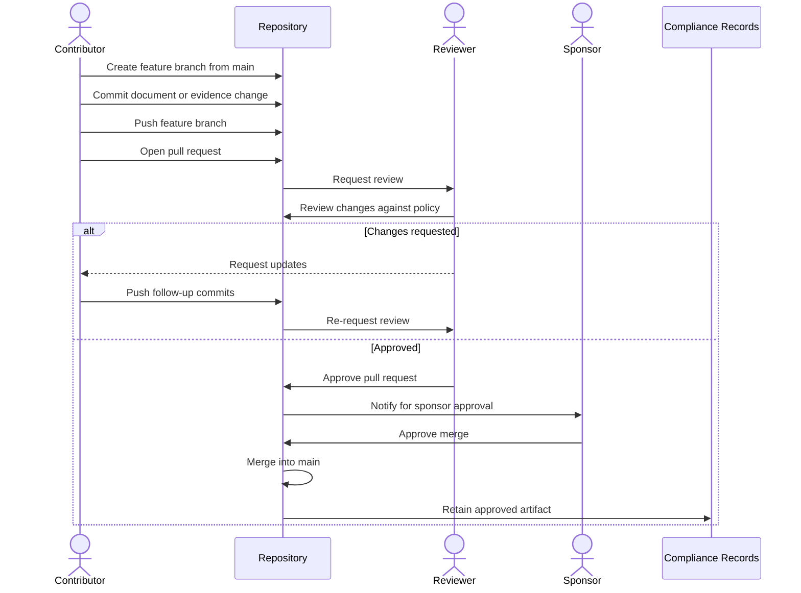

# Sequence Flow Document

## Purpose
This document describes the sequence of interactions in the security-compliance workflow, from change submission to compliance evidence retention.

## Participants
- **Contributor**: Authors a change or compliance artifact.
- **Repository**: Hosts branches, commits, and pull requests.
- **Reviewer**: Reviews the change for accuracy and policy alignment.
- **Sponsor**: Approves external communication and promotion of knowledge.
- **Compliance Records**: Archive of approved artifacts and evidence.

## Main sequence

## Step descriptions
1. **Branch**: The contributor creates a feature branch from `main`. Direct pushes to `main` are not permitted.
2. **Commit**: The contributor makes a small, focused change with a clear commit message.
3. **Push**: Only the feature branch is pushed.
4. **Pull request**: The contributor opens a pull request describing the change.
5. **Review**: The reviewer checks the change; updates loop until approved.
6. **Approval**: The sponsor approves the merge.
7. **Merge and retention**: The change is merged into `main` and the artifact is retained for audit.

## Failure handling
- If authentication fails, stop and resolve access before continuing.
- If a push or pull request creation fails, record the error and report it.
