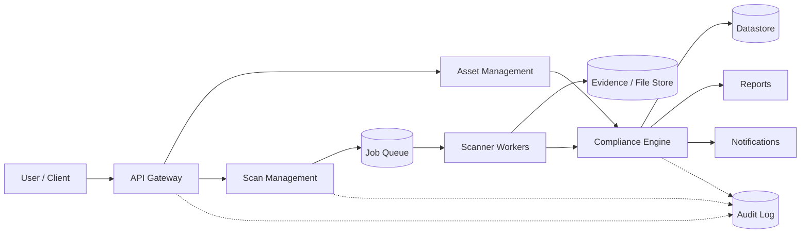
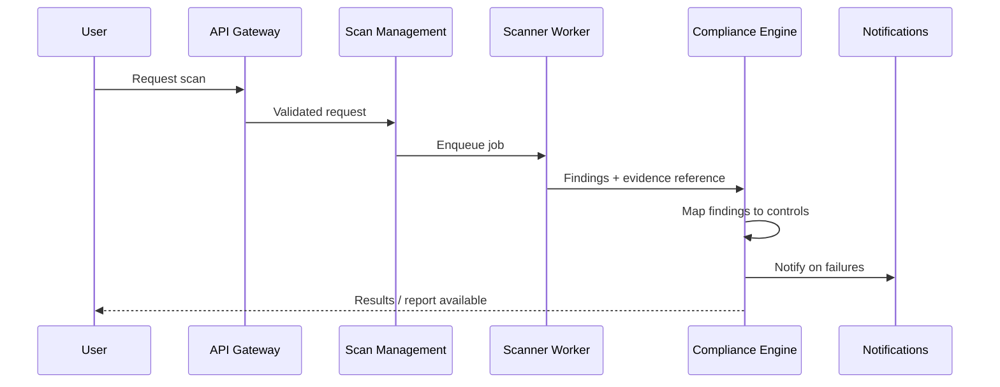

# System Design Flow

## Purpose
Describes the end-to-end flow of the security-compliance system: how assets are registered, scanned, evaluated against controls, and reported. Maintainer: security-compliance team (reviewer to be recorded in PR).

## Components
| Component | Responsibility |
|-----------|----------------|
| Client / UI / API consumer | Submits requests and views compliance results |
| API gateway | Authentication, authorization, request validation, rate limiting |
| Asset management service | Inventory of assets and their owners |
| Scan management service | Schedules, dispatches, and tracks scans |
| Scanner workers | Execute scans against assets and emit raw findings |
| Compliance engine | Maps findings to controls and computes pass/fail status |
| Evidence and file store | Stores scan outputs, evidence, and generated reports |
| Datastore | Persistent state for assets, scans, findings, and results |
| Notification service | Alerts owners on failures and deadlines |
| Audit log | Immutable record of user and system actions |

## High-level flow

## Detailed steps
1. **Authenticate**: the client calls the API gateway; identity and role are verified.
2. **Register assets**: assets are created or updated in asset management with owner, type, and criticality.
3. **Request a scan**: a user or schedule asks scan management to scan selected assets; the request is validated and stored.
4. **Dispatch**: scan jobs are placed on the queue; workers pick them up.
5. **Execute**: workers scan the asset and write raw output to the evidence store.
6. **Evaluate**: the compliance engine maps findings to controls and records status (pass, fail, exception).
7. **Report and notify**: results are aggregated into reports; owners are notified of failures.
8. **Remediate and rescan**: owners fix issues and trigger a rescan; history is retained.
9. **Audit**: every step writes to the audit log.

## Sequence

## Data model (summary)
- **Asset**: id, name, type, owner, criticality
- **Scan**: id, asset ids, status, start/end time, requester
- **Finding**: id, scan id, severity, evidence reference
- **Control result**: control id, asset id, status, timestamp

## Non-functional considerations
- **Security**: least-privilege access, encryption in transit and at rest, no secrets in the repository.
- **Reliability**: queued, retryable scan jobs; idempotent processing.
- **Auditability**: append-only audit log; retained evidence per retention policy (see `file-management.md`).
- **Scalability**: scanner workers scale horizontally.

## Open questions
- Target scanners and control frameworks to support.
- Retention periods for evidence.
- Hosting and deployment model.
